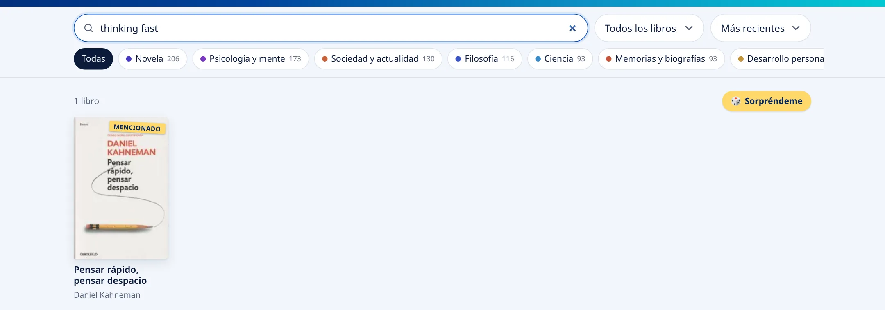
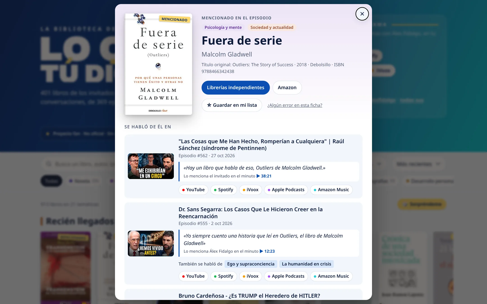
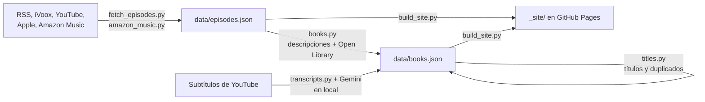

<div align="center">
  
  <h1>La biblioteca de Lo que tú digas</h1>
  <p><strong>Todos los libros de los que se ha hablado en <em>Lo que tú digas</em>, con el episodio y el minuto exacto en que se mencionan.</strong></p>
  <p>
    <a href="https://github.com/jgalilea/lqtd-book-index/actions/workflows/update-episodes.yml"></a>
    <a href="LICENSE"></a>
  </p>
  <p><a href="https://jgalilea.github.io/lqtd-book-index/"><strong>Abrir la web</strong></a> · <a href="#cómo-se-hace">Cómo se hace</a> · <a href="#desarrollo">Desarrollo</a></p>
</div>

<picture>
  <source media="(prefers-color-scheme: dark)" srcset="docs/screenshots/inicio-dark.webp">
  
</picture>

Web fan (no oficial y sin ánimo de lucro) con los libros de los invitados de *LO QUE TÚ DIGAS*, el podcast de Álex Fidalgo, y los que se mencionan en cada conversación. Están clasificados por temática y enlazados a los episodios en los que se habló de ellos.

## Qué tiene

- **Libros de los invitados y libros mencionados.** Los primeros salen de las descripciones de los episodios. Los segundos, de lo que se dice en la conversación, con la cita y un enlace al minuto exacto del vídeo.
- **Búsqueda en español y en el idioma original.** Se puede buscar por libro, autor, temática o episodio. «Outliers» encuentra «Fuera de serie» y «thinking fast», «Pensar rápido, pensar despacio».
- **Una ficha por libro** (`/#id-del-libro`), con dónde comprarlo y todos los episodios en los que salió.
- **Estanterías por temática** con filtros en la URL (`?tema=salud`), y una de **los más citados**, los libros de los que se habló en más episodios (`?orden=citados`).
- **Mi lista.** «Guardar en mi lista» en cada ficha. Se guarda en el `localStorage` del navegador, sin cuentas ni servidor, y se ve como estantería y con `?libros=mi-lista`.
- **Sorpréndeme**, que abre un libro al azar de los que se ven en ese momento.
- **Se actualiza sola** los días que sale episodio, con GitHub Actions.
- **Ligera:** HTML, CSS y JS sin dependencias, con portadas servidas como miniaturas WebP desde la propia web.

<table>
  <tr>
    <td width="50%">
      <picture>
        <source media="(prefers-color-scheme: dark)" srcset="docs/screenshots/busqueda-dark.webp">
        
      </picture>
      <p align="center"><sub>Se encuentra por el título original o por el español.</sub></p>
    </td>
    <td width="50%">
      <picture>
        <source media="(prefers-color-scheme: dark)" srcset="docs/screenshots/ficha-dark.webp">
        
      </picture>
      <p align="center"><sub>Cada mención lleva la cita y el minuto del vídeo.</sub></p>
    </td>
  </tr>
</table>

## Cómo se hace

Los datos son dos ficheros JSON en `data/`, y la web es estática:



| Paso | Dónde se ejecuta | Qué hace |
| --- | --- | --- |
| `fetch_episodes.py`, `amazon_music.py` | Action | Episodios nuevos y sus enlaces en cada plataforma |
| `books.py` | Action | Libros de las descripciones, fichas y portadas |
| `transcripts.py` | Local (`update_local.sh`) | Libros mencionados en la conversación |
| `titles.py` | Local (`update_local.sh`) | Títulos en otros idiomas y fusión de duplicados |
| `build_site.py` | Action | Web estática con miniaturas de las portadas |

### Episodios: `data/episodes.json`

```sh
pip install -r requirements.txt   # yt-dlp (YouTube) y Pillow (miniaturas)
python3 scripts/fetch_episodes.py
```

- **Fuente principal:** el RSS de Spotify for Creators (`spreaker.com/show/5819922/episodes/feed`), con descripción completa, fecha, duración, MP3 y enlace de cada episodio.
- **Enlaces de iVoox:** se sacan del listado paginado de iVoox (JSON-LD de cada página).
- **Enlaces de YouTube:** se sacan del canal [@loquetudigas](https://www.youtube.com/@loquetudigas) con yt-dlp. Los títulos de YouTube son distintos de los del podcast, así que se emparejan por número de episodio, por similitud de título, por el nombre del invitado y por duración, respetando el orden cronológico. `--youtube-full` fuerza el listado completo del canal.
- **Enlaces de Apple Podcasts:** con la API pública de iTunes (sin clave), emparejados por GUID. Solo da los 200 episodios más recientes: los anteriores no tienen enlace, pero cada episodio nuevo lo tendrá.
- **Enlaces de Amazon Music:** `scripts/amazon_music.py`. Amazon Music no tiene RSS ni API pública, así que abre la página del programa con un navegador sin interfaz (Playwright) y empareja los episodios por título, que es el mismo que en el RSS. Solo busca los episodios sin enlace; la Action instala Playwright únicamente cuando hace falta.
- **Incremental:** el fichero hace también de estado. Los episodios que ya están no se tocan; `--refresh` vuelve a escribir los campos de origen sin borrar los añadidos.

Los episodios #181–#258 (salvo #238, #240 y #256) no están publicados en abierto.

### Libros: `data/books.json`

```sh
python3 scripts/books.py
```

Es un fichero **curado a mano**: título, autor, temáticas (`themes`, de la lista que hay en el propio fichero) y episodios de cada libro. El histórico se extrajo leyendo las descripciones de los episodios. Incluye los libros de los invitados y también los que se mencionan en el episodio sin ser suyos; estos llevan `"relation": "mencionado"`. Solo se cuentan títulos explícitos («ha escrito dos libros» no basta). El script lo completa de forma incremental:

1. **Libros de episodios nuevos:** revisa los episodios que no están en `checked_episodes` y busca libros en su descripción («Compra 'X'», «publica el libro 'X'»…). Lo que encuentra se marca con `"review": true` y sin temáticas: hay que revisarlo y asignarle temáticas a mano. Acierta en torno al 70 % de los casos; los títulos sin comillas se le escapan.
2. **Fichas:** a los libros sin `lookup` les añade ISBN, año, editorial y portada desde [Open Library](https://openlibrary.org). Si la obra tiene ediciones en varios idiomas, usa la portada de la edición española. Las portadas que no están en Open Library se buscan una vez en el buscador de la librería [Agapea](https://www.agapea.com) (su `robots.txt` lo permite; una consulta por segundo como máximo). Si existe la variable `GOOGLE_BOOKS_API_KEY` (clave gratuita de Google Books), la usa primero, porque tiene más portadas de ediciones españolas. Nunca sobrescribe un campo que ya tenga valor.

`--no-detect` se salta el paso 1 y `--no-enrich`, el 2. Para corregir algo (una portada equivocada, un autor, una temática) se edita `data/books.json` directamente.

### Libros mencionados en la conversación: `scripts/transcripts.py`

**Se ejecuta en local, no en la Action**: YouTube bloquea la descarga de subtítulos desde los servidores de GitHub («Sign in to confirm you're not a bot»). Desde una conexión normal funciona sin problema.

#### Cómo ejecutarlo

Requisitos: Python 3, Git, [Node.js](https://nodejs.org) (yt-dlp lo usa para leer YouTube) y permiso para hacer push al repo.

1. Crea una clave gratuita de Gemini en [Google AI Studio](https://aistudio.google.com/apikey) y guárdala en `.env` (está en `.gitignore`, no se sube nunca):

   ```sh
   echo "GEMINI_API_KEY=tu_clave" > .env
   ```

2. Después de que salgan episodios nuevos (martes y viernes), ejecuta:

   ```sh
   ./scripts/update_local.sh
   ```

   El script crea un entorno virtual en `.venv/` (solo la primera vez), hace `git pull` para traer los episodios que haya añadido la Action, busca los libros de los episodios pendientes, revisa sus títulos y duplicados, completa sus fichas y portadas, pasa los [tests](#tests) y, si hay cambios, hace commit y push de `data/`. La Action publica la web en un par de minutos.

   - `NO_PUSH=1 ./scripts/update_local.sh` lo deja todo en local para revisarlo antes de subirlo.
   - Las opciones extra se pasan a `transcripts.py`, por ejemplo `./scripts/update_local.sh --limit 5`.
   - `python3 scripts/transcripts.py --dry-run --episode 554` muestra lo que encontraría en un episodio sin guardar nada.

3. Revisa de vez en cuando los libros nuevos en `data/books.json`: a veces se cuela alguna película o un título mal transcrito.

#### Qué hace

Para los episodios con vídeo que no estén en `transcripts_checked`:

1. Descarga los subtítulos automáticos en español de YouTube (yt-dlp) a `.cache/transcripts/`. **Las transcripciones no se suben al repo**: solo se publica lo que se extrae de ellas.
2. Gemini (capa gratuita) lista los libros que se mencionan con su título en español y el original, corrige los nombres mal transcritos y propone temáticas. Usa `gemini-3.5-flash-lite` (rápido y suficiente) y, si está saturado o sin cuota, `gemini-3.6-flash` y `gemini-3.5-flash`; `--model` permite elegir otro.
3. Se descartan los títulos que no aparecen en la transcripción, ni en español ni en el idioma original (libros inventados o menciones en las que solo se nombra al autor). Los demás se buscan entre los libros que ya hay, por cualquiera de sus títulos, y si son nuevos, en Open Library; los que no encuentra quedan con `review: true`. Aun así se cuelan películas, series y discos: conviene revisar a mano los libros nuevos de vez en cuando.
4. Cada mención se guarda en el libro como `mentions: [{episode, t, by, quote}]`: la web enseña la cita y enlaza al minuto exacto del vídeo.

Es reanudable: guarda tras cada episodio y, si Gemini no está disponible, para y sigue en la siguiente ejecución.

### Un libro, una ficha: `scripts/titles.py`

Un mismo libro puede aparecer con su título original y con el de la traducción («Outliers» / «Fuera de serie») o con dos versiones de un título mal transcrito. `update_local.sh` ejecuta `titles.py` después de `transcripts.py`:

1. Gemini da, para cada libro nuevo, el título original (`original_title`) y el publicado en España (si es otro, va a `aka`). La web busca por todos ellos y la ficha enseña el título original.
2. Los libros del mismo autor que comparten algún título se fusionan en uno (se queda el de título en español). El id del fusionado queda en `old_ids`, así que sus enlaces `/#id` y la «Mi lista» de cada navegador siguen funcionando.
3. Los de títulos muy parecidos solo se proponen, porque a veces son libros distintos («Breve historia del tiempo» / «Brevísima historia del tiempo»):

   ```sh
   python3 scripts/titles.py --merge ID_QUE_SE_QUEDA ID_QUE_SE_VA   # son el mismo
   python3 scripts/titles.py --distinct ID1 ID2                     # no lo son
   ```

   Las parejas `--distinct` se guardan en `not_duplicates` y no se vuelven a proponer ni a fusionar, aunque Gemini les dé un título en común.

`--dry-run` enseña qué haría sin guardar nada. Sin clave de Gemini solo fusiona con los títulos que ya hay.

## La web

HTML, CSS y JS sin dependencias, en `site/`. `scripts/build_site.py` la copia a `_site/` junto con un `books.json` compacto que ya incluye los datos de los episodios:

```sh
python3 scripts/build_site.py && python3 -m http.server -d _site
```

Con Pillow instalado (`pip install -r requirements.txt`), la build descarga además las portadas y las sirve desde la propia web como miniaturas WebP de 200 y 400 px (`_site/covers/`), que el navegador elige según la pantalla. Pesan unas 5 veces menos que las originales de Open Library y no dependen de su velocidad. Las descargas quedan en `.cache/covers/` (en la Action, en la caché de GitHub), así que cada build solo descarga las portadas nuevas. Sin Pillow, o si una descarga falla, se enlaza la portada original. Los libros sin portada muestran una generada con el color de su temática.

Además de lo que se cuenta en [Qué tiene](#qué-tiene):

- **«¿Algún error en esta ficha?»:** abre una incidencia de GitHub con el formulario `.github/ISSUE_TEMPLATE/correccion.yml` ya rellenado (libro, enlace y episodios). Las correcciones llegan con la etiqueta `corrección`; se arreglan editando `data/books.json`.
- **Vista previa al compartir:** `site/og-image.jpg` (1200×630) y etiquetas Open Graph en `index.html`.
- **Modo oscuro** automático, según el sistema.

## Actualización y publicación automáticas

`.github/workflows/update-episodes.yml`:

- Los martes y viernes a las 08:00 UTC (los episodios salen esos días a las 07:00, hora de Madrid) y todos los días a las 21:00 UTC ejecuta `fetch_episodes.py`, `books.py` y `amazon_music.py`. Si `data/` cambia, hace commit, pasa los tests y vuelve a publicar la web.
- Cada push a `main` que toque la web, los datos, los scripts de títulos o los tests la vuelve a publicar.
- Para usar Google Books, añade la clave como *secret* `GOOGLE_BOOKS_API_KEY` en *Settings → Secrets and variables → Actions*.

## Desarrollo

```sh
git clone https://github.com/jgalilea/lqtd-book-index.git
cd lqtd-book-index
python3 -m venv .venv && .venv/bin/pip install -r requirements.txt
.venv/bin/python scripts/build_site.py && python3 -m http.server -d _site
```

La web queda en http://localhost:8000. Sin Pillow también funciona, con las portadas enlazadas a su origen.

### Tests

```sh
python3 -m unittest discover tests
```

- `tests/test_titles.py` prueba la lógica de títulos y fusiones con libros de ejemplo, sin red ni Gemini: qué libro se queda, qué se suma, los `--distinct`, que un libro se encuentre por su título en cualquier idioma…
- `tests/test_data.py` revisa `data/books.json`: ids únicos, `old_ids` que no chocan, duplicados sin fusionar, que todos los títulos lleguen a la búsqueda de la web y que no se hayan vuelto a fusionar libros que ya se fusionaron mal una vez («Crimen y castigo» / «Los demonios»).

La Action los ejecuta antes de publicar la web y `update_local.sh`, antes de hacer push.

## Licencia

Código bajo [licencia MIT](LICENSE). *Lo que tú digas*, su logo, las portadas de los libros y las miniaturas de los vídeos pertenecen a sus respectivos dueños; este proyecto es una web fan sin relación con el programa.
